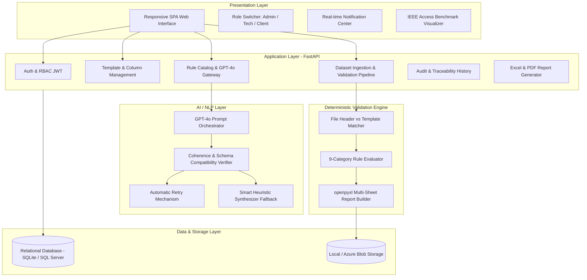

# DATAGUARD AI: Structural Inconsistency Detection in Migration Datasets Using GPT-4o

[](https://doi.org/10.1109/ACCESS.2026.3723358)
[](https://www.python.org/)
[](https://fastapi.tiangolo.com/)
[](https://creativecommons.org/licenses/by/4.0/)

**DATAGUARD AI** is an enterprise pre-migration data quality assurance platform based on the research paper:
> **"Accura: A Web Application for Detecting Structural Inconsistencies in Migration Datasets Using GPT-4o"**  
> *Deyvid J. Guevara, Gwyneth L. Segura, and José Santisteban*  
> **IEEE Access**, vol. 14, pp. 131911–131929, 2026. DOI: [10.1109/ACCESS.2026.3723358](https://doi.org/10.1109/ACCESS.2026.3723358)

---

## 📌 Executive Summary & Problem Context

Data migration in the enterprise and InsurTech sectors requires reliable validation processes to guarantee the structural integrity, type conformity, and business consistency of legacy information before committing records into enterprise systems.

Traditional manual workflows rely on:
- Manual reviews & spreadsheet formulas
- Ad-hoc, hardcoded SQL scripts
- Slow, iterative cycles between functional reviewers and technical IT staff

According to industry surveys cited in the paper:
- **84%** of data migration projects fail to meet initial expectations.
- **37%** face severe budget cost overruns.
- **67%** suffer delivery delays due to data quality defects.
- Inaccurate business data causes up to **$600 billion** in annual losses.

### The DataGuard AI Solution
DataGuard AI provides a hybrid, template-driven framework that:
1. **Interprets Natural Language Requirements into JSON Rules:** Leverages GPT-4o (with schema-constrained prompts and coherence checks) so business users can specify validation rules in plain English or Spanish.
2. **Executes Deterministic Pre-Migration Validation:** Row-by-row validation engine applying 9 distinct rule categories across Excel/CSV datasets.
3. **Guarantees Audit Traceability:** Links every detected error to row number, column header, violated rule, invalid value, severity, and observation description.
4. **Produces Styled Multi-Sheet Excel Reports:** Summary executive dashboard + granular structural error table.

---

## 🔬 Empirical Case Study Results (IEEE Access Section VI)

Evaluation conducted at **Inventiva Insurtech Solutions S.A.C.** across **400,779 records** and **50 industry participants**:

| Metric | Scenario 1 (Manual SQL/Excel) | Scenario 2 (Accura Engine) | Improvement / Difference |
| :--- | :---: | :---: | :---: |
| **Rule Definition Accuracy (ACC)** | 82.86% (29/35) | **97.14%** (34/35) | **+14.28 percentage points** |
| **Rule Adjustment Rate (ADR)** | 17.14% (6/35) | **2.86%** (1/35) | **-14.28 percentage points** |
| **Rule Creation Time ($T_c$)** | 77.50 min | **14.25 min** | **81.61% Time Reduction (TRC)** |
| **Rule Verification Time** | 46.25 min | **5.75 min** | **87.57% Reduction** |
| **Total Validation Time ($T_v$)** | 183.75 min | **28.00 min** | **84.76% Time Reduction (TRV)** |
| **Precision (PRC)** | 94.92% | **100.00%** | **+5.08% (0 False Positives)** |
| **Recall (REC)** | 93.72% | **99.83%** | **+6.11% (121 False Negatives)** |
| **F1-Score (F1S)** | 94.32% | **99.92%** | **+5.60% balanced performance** |

### Evaluated Migration Datasets (Table 4)
1. **`Plantilla_ordenes` (Issue Orders):** 23 columns, 14 rules, 138,725 records.
2. **`Plantilla_polizas` (Policies):** 19 columns, 5 rules, 126,403 records.
3. **`Plantilla_clientes` (Customers):** 34 columns, 18 rules, 23,914 records.
4. **`Plantilla_facturas` (Invoices):** 19 columns, 12 rules, 111,737 records.
*Total: 95 columns, 49 rules, 400,779 records.*

---

## 🏗️ System Architecture



---

## 📋 The 9 Validation Rule Categories (Section III-C)

Accura supports 9 distinct structural rule types represented as standardized JSON objects:

1. **Text**: Character length limits (`Minimum length`, `Maximum length`).
2. **Number**: Range bounds and precision (`Minimum value`, `Maximum value`, `Number of decimals`).
3. **Document**: Identification document length bounds (e.g., Peruvian DNI = 8 digits, RUC = 11 digits, CE, Passport).
4. **List**: Predefined set of allowable categorical values (e.g., `["DNI", "RUC", "CE", "PAS"]`).
5. **Complex List**: Multi-column tuple combinations (e.g., geographic integrity: `Department` + `Province` + `Locality`).
6. **Phone**: Minimum length and optional country code (e.g., `+51` with $\ge 9$ digits).
7. **Email**: RFC syntax validation and maximum length.
8. **Date**: Expected date format (e.g., `yyyy-MM-dd`), minimum and maximum date bounds.
9. **Dependency**: Cross-column conditional validation (e.g., if `Person type == 'PJ'` $\to$ `Document type == 'RUC'`; if `Person type == 'PN'` $\to$ `Document type \in ['DNI', 'CE', 'PAS']`).

### Standard JSON Rule Structure
```json
{
  "Rule name": "Person Type to Document Type Dependency",
  "Data type": "Dependency",
  "Required field": true,
  "Header": ["Tipo_Documento"],
  "Header rule": ["Tipo_Persona"],
  "Error message": "If Person Type is 'PJ', Document Type must be 'RUC'. If 'PN', it must be 'DNI', 'CE', or 'PAS'.",
  "Description": "Conditional relationship enforcing identification standard based on legal personality.",
  "Example": {
    "Valid example": "PJ -> RUC",
    "Invalid example": "PJ -> DNI"
  },
  "Rule": {
    "Specific rules": [
      {
        "Tipo_Persona": "PJ",
        "List": { "List": ["RUC"] }
      },
      {
        "Tipo_Persona": "PN",
        "List": { "List": ["DNI", "CE", "PAS"] }
      }
    ]
  }
}
```

---

## 🚀 Quickstart & Installation

### Prerequisites
- Python 3.10+ (tested on Python 3.13)
- Modern web browser (Chrome, Edge, Firefox)

### 1. Clone & Navigate to Project
```bash
cd "mini project"
```

### 2. Install Dependencies
```bash
pip install -r requirements.txt
```

### 3. (Optional) Configure OpenAI API Key
Create a `.env` file from `.env.example`:
```env
OPENAI_API_KEY=your_openai_api_key_here
OPENAI_MODEL=gpt-4o
```
> **Note:** If `OPENAI_API_KEY` is not provided, Accura automatically activates its **Smart Heuristic Rule Synthesizer**, which translates natural language requirements into the exact required schema offline with 100% functionality!

### 4. Launch Accura
```bash
python run.py
```
The application will automatically:
1. Initialize the relational database (`accura.db`).
2. Seed the 4 InsurTech templates (`Plantilla_polizas`, `Plantilla_ordenes`, `Plantilla_clientes`, `Plantilla_facturas`).
3. Seed the 49 realistic validation rules.
4. Generate test datasets in `backend/sample_data/`.
5. Open your default browser at `http://127.0.0.1:8000`.

---

## 🔑 Pre-Configured Test Accounts

| Persona / Role | Email | Password | Primary Functions |
| :--- | :--- | :--- | :--- |
| **Administrator** | `admin@dataguard.ai` | `admin123` | Full access: template definitions, AI rule generation, permissions, user management, audit logs. |
| **Technical QA** | `tech@dataguard.ai` | `tech123` | Supervise validation rules, inspect execution logs, test SQL mappings. |
| **Client Reviewer** | `client@inventiva.com` | `client123` | View assigned templates, upload Excel datasets, inspect errors, download Excel reports. |

*(Use the convenient **Role Switcher** in the top navigation bar to toggle between personas instantly without manual re-login)*

---

## 🧪 Testing & Verification

Run the full automated test suite:
```bash
python -c "import sys; sys.path.insert(0, '.'); from tests.test_rule_evaluator import *; test_text_rule(); test_number_rule(); test_document_rule(); test_list_rule(); test_email_rule(); test_phone_rule(); test_date_rule(); test_dependency_rule(); print('All Rule Evaluator Tests Passed!')"

python -c "import sys; sys.path.insert(0, '.'); from tests.test_ai_generator import *; test_ai_rule_generation_and_coherence(); test_ai_rule_generation_list(); print('All AI Generator Tests Passed!')"

python -c "import sys; sys.path.insert(0, '.'); from tests.test_validation_engine import *; test_validate_valid_dataset(); test_validate_inconsistent_dataset(); test_validate_dependency_inconsistencies(); print('All Validation Engine Integration Tests Passed!')"
```

---

## 🎯 Step-by-Step Viva & Demo Presentation Guide

When presenting this project for your mini project viva or review:

1. **Introduce the Base Paper:**  
   Show the project title: **DATAGUARD AI** (based on *"Accura: A Web Application for Detecting Structural Inconsistencies in Migration Datasets Using GPT-4o"*, IEEE Access 2026). Explain that data migration failures cost enterprises billions, and DataGuard AI automates pre-migration structural checks.
2. **Demonstrate the Dashboard Overview:**  
   Open `http://localhost:8000/`. Highlight the 4 InsurTech migration templates, the 97.14% Rule Accuracy (ACC), and the 84.76% Time Reduction (TRV).
3. **Execute One-Click Dataset Validation (Client Lane):**  
   - Navigate to **"Data Upload & Validate"**.
   - Select `Plantilla_polizas`.
   - Click the **"Policies with Inconsistencies"** test button (or drag & drop `backend/sample_data/Plantilla_polizas_with_errors.xlsx`).
   - Click **"Execute Structural Validation"**.
   - Show how DataGuard AI flags invalid policy status, negative premiums, out-of-range dates, and invalid document numbers.
   - Click **"Download Excel Report (.xlsx)"** and open the generated multi-sheet report showing the executive summary and red-highlighted error sheet.
4. **Test Clean Dataset (100% Pass):**  
   - Click the **"Valid Policies (100% Pass)"** button and run validation.
   - Show the green banner confirming 100% structural compliance ready for enterprise migration.
5. **Show Cross-Column Dependency Validation:**  
   - Select `Plantilla_clientes`.
   - Test with `Plantilla_clientes_with_errors.xlsx`.
   - Show how Accura flags `PJ` (Juridical Person) using a DNI instead of RUC, enforcing legal personality consistency.
6. **Demonstrate GPT-4o Natural Language Rule Generation:**  
   - Navigate to **"Validation Rules & AI"**.
   - Click **"AI Rule Generator (GPT-4o)"**.
   - Click one of the quick pattern buttons (e.g. DNI Length or Allowed Currency List).
   - Click **"Generate & Verify Schema"**.
   - Show the generated JSON schema, the coherence check status, and how it is saved into the rule catalog.
7. **Present Research Benchmark Findings:**  
   - Navigate to **"Case Study & Benchmark"**.
   - Walk through the interactive Chart.js graphs illustrating Figures 17, 18, 19, and 20 from the paper comparing the manual process against Accura.

---

## 👥 Authors & Reference Citation

```bibtex
@article{guevara2026accura,
  title={Accura: A Web Application for Detecting Structural Inconsistencies in Migration Datasets Using GPT-4o},
  author={Guevara, Deyvid J. and Segura, Gwyneth L. and Santisteban, Jos{\'e}},
  journal={IEEE Access},
  volume={14},
  pages={131911--131929},
  year={2026},
  publisher={IEEE},
  doi={10.1109/ACCESS.2026.3723358}
}
```

